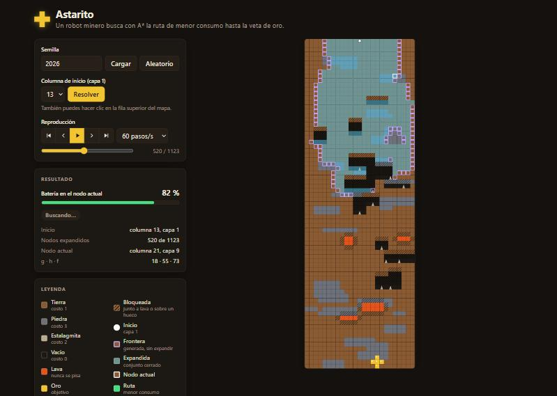
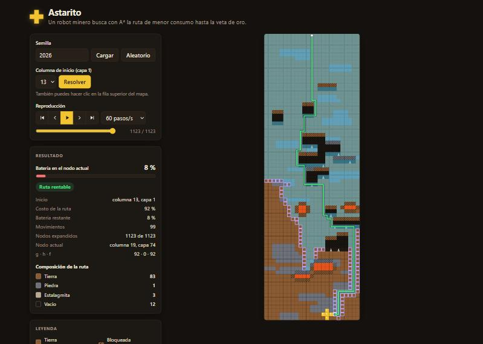
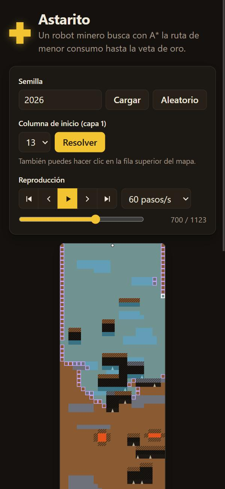

# Astarito

Un robot minero con batería limitada busca, con **A\*** y una **heurística de problema relajado**, la ruta de menor consumo desde la superficie hasta una veta de oro. El navegador reproduce la búsqueda paso a paso.

Proyecto de la materia **Fundamentos de Inteligencia Artificial**. El nombre es un juego de palabras: *A-Star-ito*.

**Demo en vivo:** <https://astarito.vercel.app>. Para ver el mapa de las capturas: <https://astarito.vercel.app/?seed=2026> con la columna 13.

| Búsqueda en curso | Ruta encontrada | Móvil |
| --- | --- | --- |
|  |  |  |

## El problema

- **Mapa:** un corte sagital del subsuelo de **25 columnas × 75 capas**, generado a partir de una semilla. Tiene tierra, lajas de piedra, cuevas con estalagmitas, lagos de lava y una veta de oro en forma de "+" cerca del fondo.
- **Robot:**
  - empieza en cualquier columna de la capa 1 (la eliges tú) con **100 % de batería**;
  - se mueve a la izquierda, a la derecha o hacia abajo, nunca hacia arriba;
  - cada movimiento cuesta lo que cuesta minar la casilla de destino.

| Material | Costo |
| --- | --- |
| Tierra | 1 |
| Piedra | 3 |
| Estalagmita | 2 |
| Vacío (cueva) | 0 |
| Lava, oro | no se pisan |

- **Meta:** cualquier casilla vecina al oro.
- **Éxito:** la ruta cuesta ≤ 100. Llegar con 0 % exacto también cuenta.
- **Casillas bloqueadas:**
  - la lava y sus vecinas;
  - toda casilla que tenga un hueco (vacío o estalagmita) justo debajo.

  Así el robot nunca cae más de una casilla: recorre las cuevas por el piso y mina las estalagmitas de lado.

La especificación completa, con el análisis PEAS, las pruebas de admisibilidad y consistencia y las decisiones de diseño, está en [`docs/propuesta.md`](docs/propuesta.md).

## Cómo funciona el agente

- **Algoritmo:** A\* con w = 1. La frontera se ordena por f = g + h, y los empates se rompen a favor del mayor g. Se descarta todo sucesor con g + h > batería, porque ya no puede llegar al oro.
  - La batería no forma parte del estado: vale 100 − g.
  - Si A\* termina sin encontrar meta, no existe ninguna ruta rentable, y el programa informa además el costo mínimo real.
- **Heurística:** h(s) es el costo exacto en un problema relajado, donde solo la lava es intransitable.
  - Se calcula una vez por mapa con un Dijkstra inverso desde las metas.
  - Es admisible y consistente, así que la primera meta que sale de la frontera es la ruta óptima.
- **Línea base:** la búsqueda de costo uniforme (h = 0) sirve de comparación; A\* expande notablemente menos nodos.

## Cómo usar la demo

1. **Elige un mapa:** escribe una semilla y presiona **Cargar**, o usa **Aleatorio**. La semilla queda en la URL (`?seed=…`), así que puedes compartir un mapa concreto.
2. **Elige el inicio:** escoge la columna en el selector y presiona **Resolver**, o haz clic directamente en la fila superior del mapa.
3. **Mira la búsqueda:**
   - las casillas expandidas se pintan de cian;
   - la frontera aparece como contorno violeta;
   - el nodo actual lleva contorno blanco;
   - al final se dibuja la ruta en verde.
4. **Controla la reproducción:** play/pausa, paso a paso, saltos al inicio o al final, velocidad (10–400 pasos/s) y un deslizador.

   **Atajos:** `Espacio` reproduce o pausa, `←` `→` avanzan un paso, `Inicio` y `Fin` saltan.
5. **Revisa el resultado:** el panel muestra el veredicto, el costo, la batería restante, los movimientos, los nodos expandidos, g · h · f del nodo actual y la composición de la ruta por material.

## Arquitectura

```text
backend/
  api.py, schemas.py     FastAPI: /api/health, /api/map, /api/solve
  agent/                 núcleo en Python puro (solo biblioteca estándar)
    config.py            constantes del problema y del generador
    materials.py         materiales y costos de minado
    grid.py              mapa inmutable
    rules.py             casillas bloqueadas, metas y sucesores
    heuristic.py         Dijkstra inverso (relajado o exacto)
    generator.py         generación por estructuras con semilla
    search.py            A* con traza de expansiones
    metrics.py           resumen de la ruta
tests/                   pytest
frontend/                Vite + TypeScript, dibujo en canvas
  src/api/               cliente y tipos del contrato
  src/state/             store mínimo
  src/render/            mapa, paleta y escala
  src/playback/          reproducción de la traza
  src/ui/                controles, resultado, batería y leyenda
public/                  frontend compilado (se versiona; lo sirve Vercel)
```

- **API sin estado:** cada petición regenera el mapa desde la semilla. `POST /api/solve` devuelve la traza completa de A\*: cada expansión con g, h, f y las casillas que entraron a la frontera. El navegador la reproduce sin WebSockets.
- **El frontend no contiene lógica del agente:** solo dibuja y reproduce lo que devuelve la API.

## Ejecución local

Requisitos: Python 3.12 o superior, pip 25.1 o superior (por los grupos de dependencias) y Node 20 o superior.

Primero, crea un entorno virtual e instala las dependencias de Python:

```bash
python -m venv .venv
```

```bash
source .venv/bin/activate
```

En Windows, en lugar de lo anterior: `.venv\Scripts\activate`.

```bash
pip install "fastapi>=0.115" --group dev
```

Luego levanta la API, que queda en <http://127.0.0.1:8000>:

```bash
uvicorn backend.api:app --reload
```

En otra terminal, levanta el frontend:

```bash
cd frontend && npm install && npm run dev
```

Abre <http://localhost:5173>. Vite reenvía `/api` a uvicorn.

### Pruebas

```bash
pytest
```

La suite (unas 750 pruebas) comprueba, entre otras cosas, que:
- A\* coincide con el Dijkstra exacto en las 25 columnas de inicio de varios mapas;
- la heurística es admisible y consistente;
- el generador es determinista y respeta las capas de cada material;
- la traza permite reconstruir la frontera;
- el contrato de la API se cumple.

### Compilar el frontend

```bash
cd frontend && npm run build
```

La salida va a `public/`, que **se versiona**: el preset de FastAPI en Vercel no publica archivos generados durante el build. Hay que recompilar y commitear `public/` junto con cada cambio del frontend.

## Despliegue

Corre en **Vercel (plan Hobby)** como un solo proyecto: FastAPI se detecta por `[tool.vercel] entrypoint = "backend.api:app"` en `pyproject.toml`, y los estáticos se sirven desde `public/`. La rama de producción es `main`.
